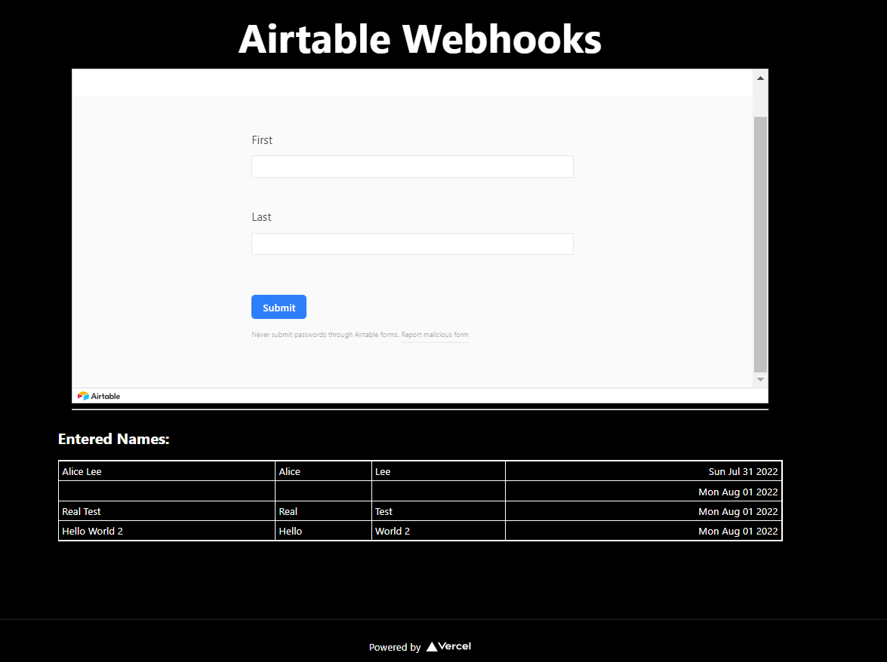
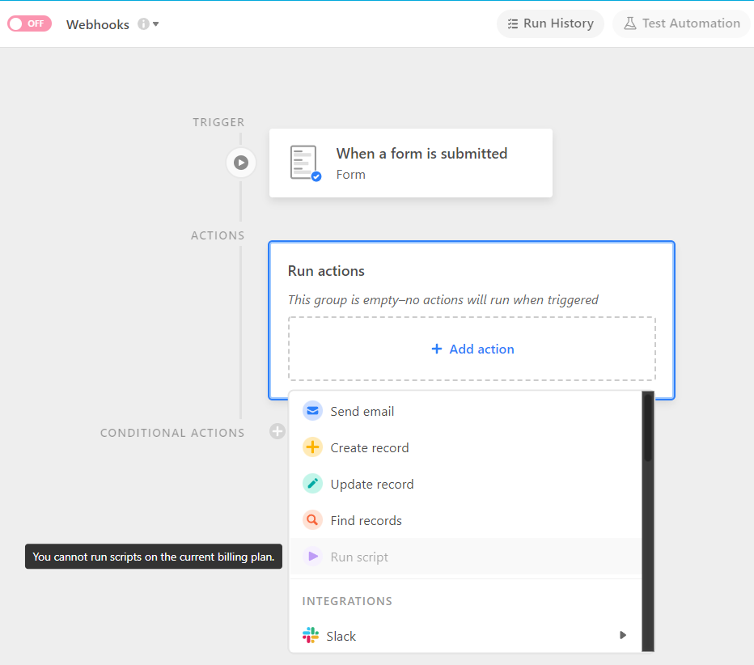
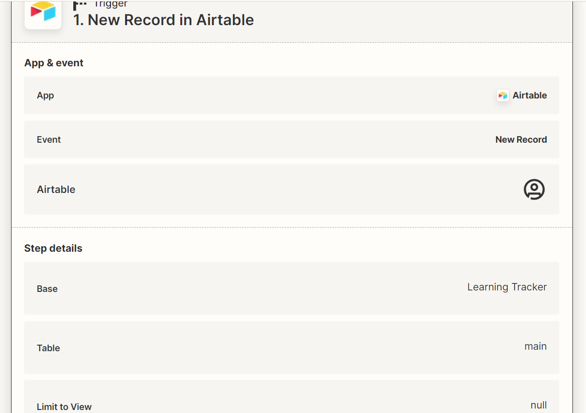
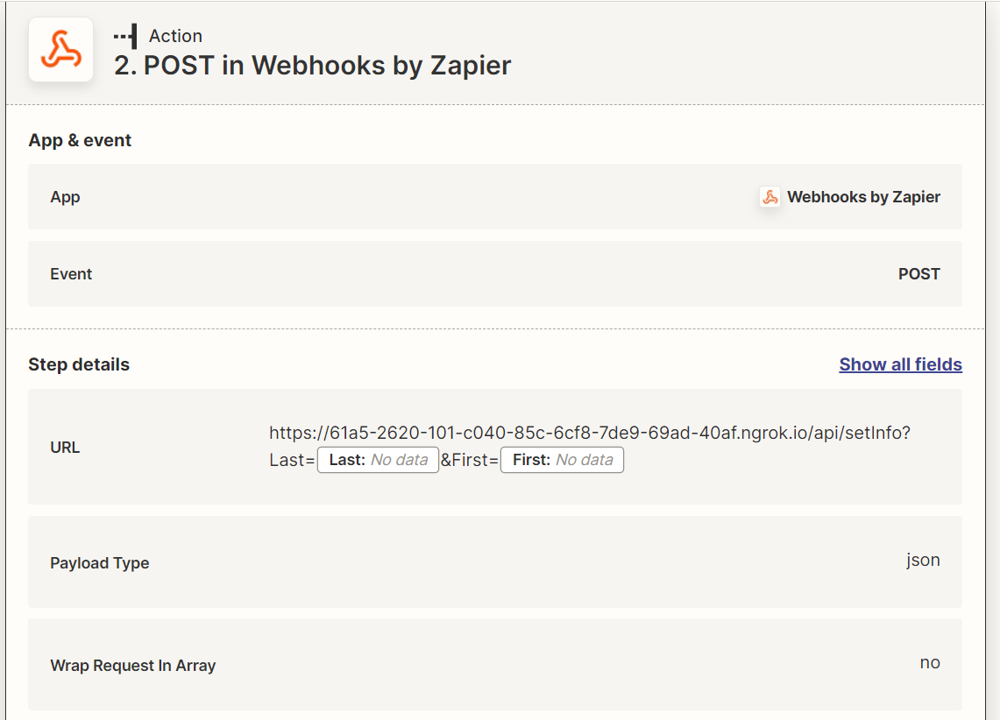

# Airtable Webhooks

Learning Webhooks from Airtable

Prisma Docs @ [prisma.io/docs/getting-started/quickstart](https://www.prisma.io/docs/getting-started/quickstart)



## Notes

These automations can be done on Airtable itself by creating a custom run script to post request but it requires premium



OR

I am using [Zapier](https://zapier.com/) to automate the process by running a webhook post on new record (there are latency issues so not real time)




## Testing

I am using ngrok to mock a public endpoint to accept requests. This will forward requests locally. The command is `ngrok.exe http 3000` on windows. I'm not sure if this works on Unix since the binary might be different

## Setup

Requires Node.js 22.12 or newer.

```bash
yarn install                # also generates the Prisma client
yarn prisma migrate deploy  # creates prisma/dev.db if it doesn't exist
yarn dev
```

`POST /api/setInfo` only accepts requests that carry a shared secret. Generate one (e.g. `openssl rand -hex 32`),
put it in `.env.local` (git-ignored; never in the committed `.env`):

```
WEBHOOK_SECRET=<your secret>
```

and add a header to the Zapier "POST in Webhooks by Zapier" step (or the Airtable script's `fetch`):

```
Authorization: Bearer <your secret>
```

Requests without the right secret get `401`, and the route returns `500` if `WEBHOOK_SECRET` isn't set.
